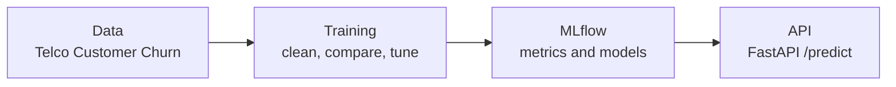
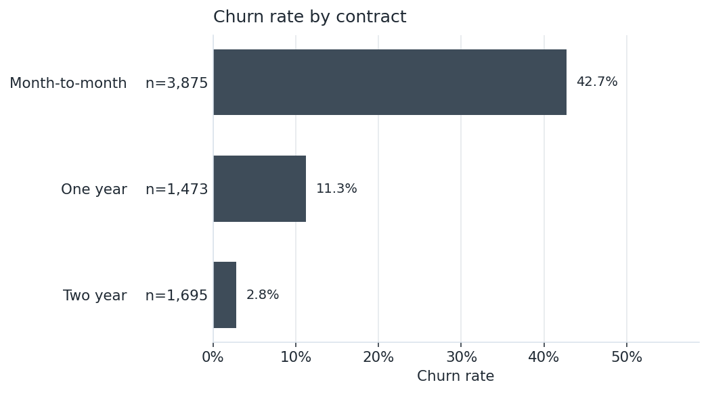
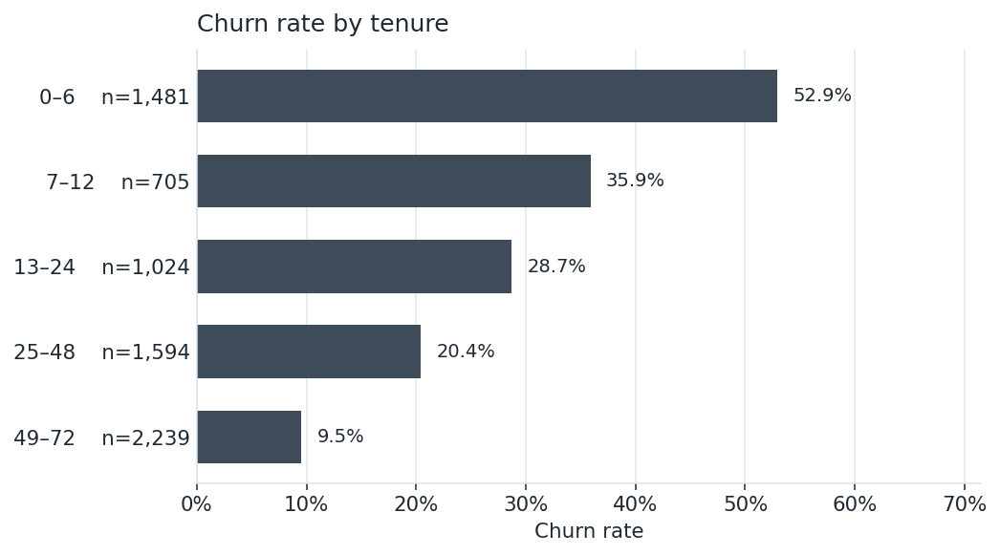
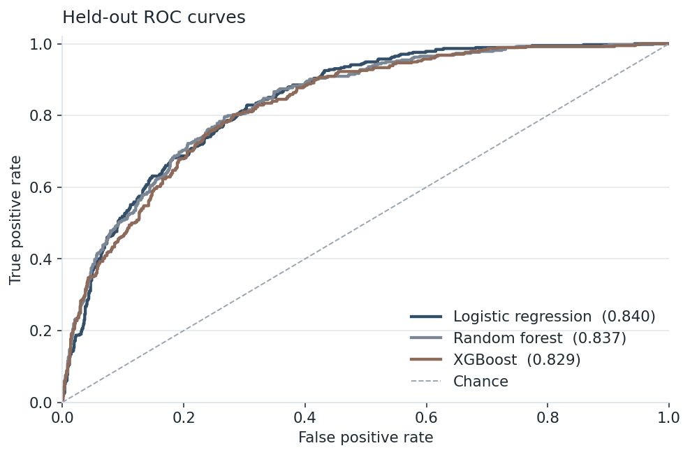
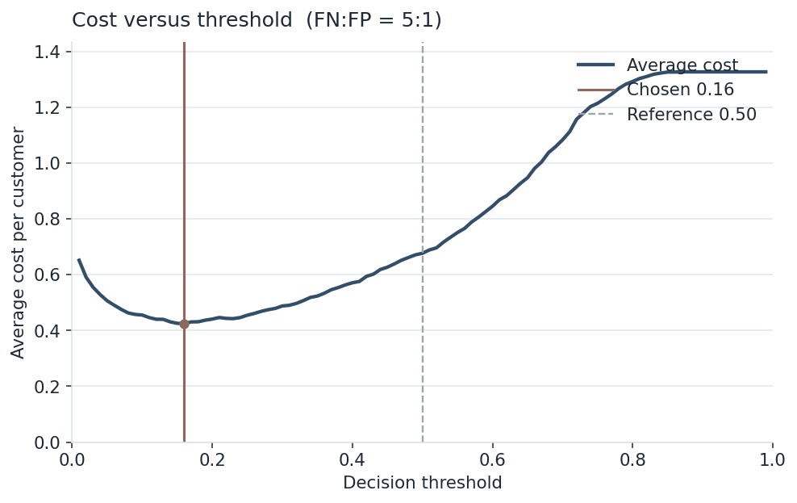
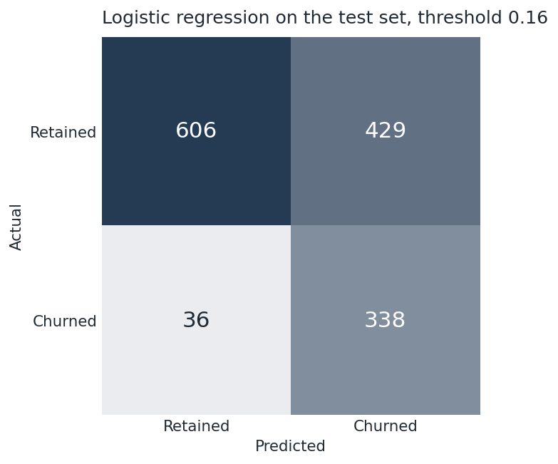
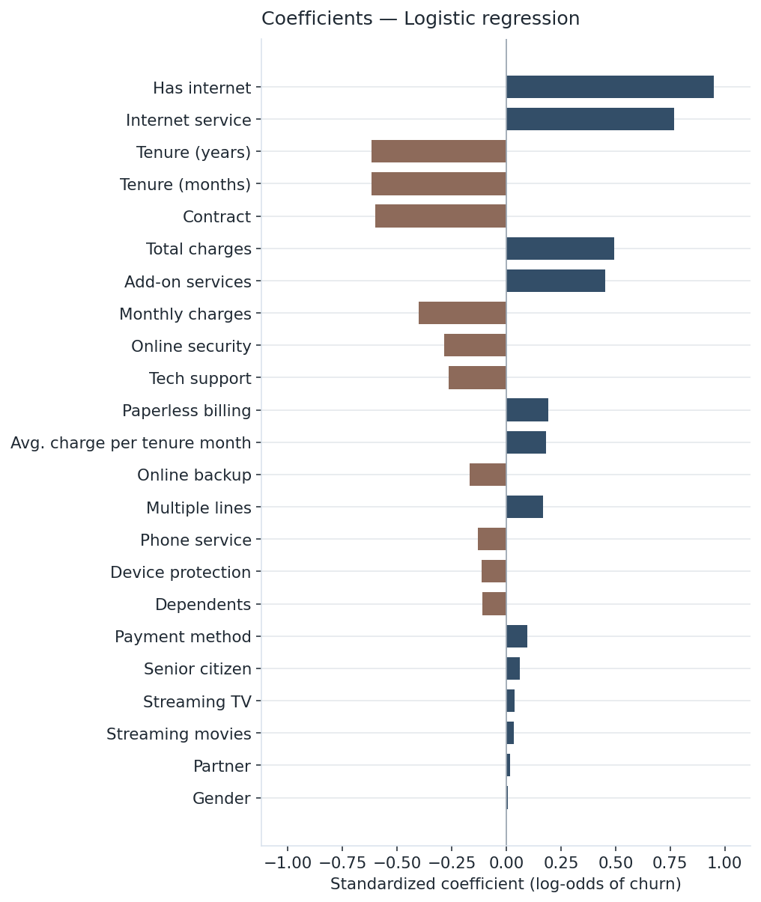

# ChurnLab

[](https://github.com/JVCSampaio/churnlab/actions/workflows/ci.yml) [](https://www.python.org/)

> **Resumo.** O ChurnLab estima a chance de um cliente de telecom cancelar o serviço a partir do conjunto real *Telco Customer Churn* da IBM (7.043 clientes; taxa de churn de 26,5%). O pipeline limpa os dados, compara regressão logística, Random Forest e XGBoost com validação cruzada estratificada (5 folds), registra os experimentos no MLflow e serve o modelo escolhido em uma API FastAPI. Pela média de ROC-AUC na validação cruzada, o modelo escolhido é regressão logística. Autor: João Vitor Sampaio.

A portfolio project by João Vitor Sampaio.

ChurnLab predicts whether a telecom customer will leave, using IBM's Telco Customer Churn extract (7,043 customers, 26.5% churn). It cleans the billing fields, compares a logistic regression with Random Forest and XGBoost, records each run in MLflow, and serves the selected model through FastAPI.

A retention offer is cheaper than winning the customer back later, so the team needs a ranked list and a cutoff it can afford. 26.5% of these customers churn (1,869 of 7,043). A classifier that always predicts "stay" is 73.5% accurate and never identifies anyone. Ranking quality is ROC-AUC. Who actually gets a call is precision and recall at a threshold.

## How to run

```bash
python -m venv .venv
source .venv/bin/activate
make setup    # editable install; no PYTHONPATH
make train    # rewrites docs/metrics.json, docs/img/, and this README
make test
make plots    # redraw figures from the saved run
make api      # http://127.0.0.1:8000
```

`make train` is the source of the numbers below. Edit `docs/metrics.json` or the tables by hand and the test suite fails.

Docker (CI builds this image on every pull request):

```bash
docker compose up --build
curl http://127.0.0.1:8000/health
```

## Architecture



Training writes a joblib pipeline and `docs/metrics.json`. The API loads that pipeline and applies the threshold stored in the same run. MLflow records parameters, metrics, and the model artifacts for the run.

| Module | Role |
|---|---|
| `config.py` | Paths, columns, split, cost ratio, the example request |
| `data.py` | Load, clean, engineer, label-encode |
| `eda.py` | Churn rate by contract and by tenure bucket |
| `model.py` | Fit, stratified cross-validation, threshold, MLflow |
| `reporting.py` | Assemble `docs/metrics.json` |
| `plots.py` | Write `docs/img/` |
| `readme.py` | Render this file from the metrics document |
| `api.py` | `GET /health`, `GET /models`, `POST /predict` |
| `pipeline.py` | `python -m churnlab.pipeline` |

## Results

Every figure and metric in this section is rendered from [`docs/metrics.json`](docs/metrics.json). The training run rewrites that file, the images, and this README together.

The extract has 7,043 customers and 11 blank `TotalCharges` values (new accounts; filled with 0). The model sees 23 columns, 4 of them engineered: tenure in years, average charge per tenure month, count of add-on services, and an internet flag.



Month-to-month is the highest, 42.7% of 3,875 customers. Two year is the lowest, 2.8% of 1,695.



The 0–6 month bucket is the highest, 52.9% of 1,481 customers. The 49–72 month bucket is the lowest, 9.5% of 2,239.

### Cross-validation

Stratified 5-fold cross-validation on the training split (5,634 rows, seed 42). Cells are mean ± sample standard deviation. Precision, recall, and F1 use the comparison cutoff 0.50 (the same cutoff for every model). ROC-AUC does not.

| Model | ROC-AUC | Precision | Recall | F1 |
| --- | --- | --- | --- | --- |
| **Logistic regression** | **0.845 ± 0.014** | **0.649 ± 0.027** | **0.549 ± 0.043** | **0.595 ± 0.033** |
| Random forest | 0.840 ± 0.010 | 0.671 ± 0.042 | 0.493 ± 0.029 | 0.568 ± 0.029 |
| XGBoost | 0.831 ± 0.009 | 0.631 ± 0.037 | 0.502 ± 0.024 | 0.559 ± 0.025 |

The shipped model is the one with the highest mean ROC-AUC across stratified folds on the training set. Logistic regression is the best model on both criteria: stratified 5-fold mean ROC-AUC (0.845 ± 0.014) and held-out ROC-AUC (0.840). Random forest and XGBoost do not beat the linear baseline here. That is the result.

### Held-out test

One stratified 80/20 holdout (1,409 rows: 374 churned, 1,035 retained). This split is not used to pick the model or the threshold. Holdout ROC-AUC runs from 0.829 to 0.840.

| Model | ROC-AUC | Precision | Recall | F1 | Accuracy |
| --- | --- | --- | --- | --- | --- |
| **Logistic regression** | **0.840** | **0.636** | **0.543** | **0.586** | **0.796** |
| Random forest | 0.837 | 0.651 | 0.508 | 0.571 | 0.797 |
| XGBoost | 0.829 | 0.603 | 0.500 | 0.547 | 0.780 |



### Decision threshold

A false negative — failing to offer retention to a customer who churns — is treated as 5 times as costly as a false positive — contacting a customer who would have stayed. The ratio 5:1 is a planning assumption, not a quantity estimated from this dataset. A retention team should replace it with offer cost and remaining customer value.

Average cost per customer is `(false negatives × 5 + false positives × 1) / n`. The minimum is taken on out-of-fold scores of the selected model. Ties resolve to the cutoff closest to 0.50.

The chosen threshold is **0.16**. On the held-out test set, precision is **0.441** and recall is **0.904** (F1 0.592). Out-of-fold, where the cutoff was selected, precision was 0.443 and recall was 0.908, at an average cost of 0.424 per customer. The same out-of-fold cost at the 0.50 reference cutoff is 0.677. Test-set average cost at the chosen threshold is 0.432; that figure was not used to pick the cutoff.





On the test set the matrix is 606 true negatives, 429 false positives, 36 false negatives, and 338 true positives.

### What the selected model uses



Largest absolute standardized coefficients: Has internet (+0.948), Internet service (+0.767), and Tenure (years) (-0.617). A positive coefficient raises the log-odds of churn after scaling. Each categorical column is a single label code, so the Contract coefficient is not a separate effect for month-to-month, one-year, and two-year. `has_internet` is 1 when Internet service is DSL or fiber, so those two coefficients share one signal.

## Serve a prediction

The request below is the example stored in the metrics file. It includes every field the API schema requires, and each category is a level from the CSV (`Credit card (automatic)`, not a shortened label). The response is what the trained model returns for that payload. `feature_names` is also included, in model order.

```bash
curl -X POST http://127.0.0.1:8000/predict \
  -H 'Content-Type: application/json' \
  -d @- <<'JSON'
{
  "customer_id": "CUST_001",
  "gender": "Female",
  "SeniorCitizen": 0,
  "Partner": "No",
  "Dependents": "No",
  "tenure": 3,
  "PhoneService": "Yes",
  "MultipleLines": "No",
  "InternetService": "Fiber optic",
  "OnlineSecurity": "No",
  "OnlineBackup": "No",
  "DeviceProtection": "No",
  "TechSupport": "No",
  "StreamingTV": "No",
  "StreamingMovies": "No",
  "Contract": "Month-to-month",
  "PaperlessBilling": "Yes",
  "PaymentMethod": "Credit card (automatic)",
  "MonthlyCharges": 70.35,
  "TotalCharges": 211.05
}
JSON
```

```json
{
  "customer_id": "CUST_001",
  "churn_probability": 0.6353,
  "will_churn": true,
  "threshold": 0.16,
  "model": "logistic_regression"
}
```

Scored by `logistic_regression`. This customer is flagged as likely to churn.

## Technical decisions

**Logistic regression is the baseline, and it has to earn the deployment.** On 7,043 rows and 23 columns a scaled linear model is a serious answer: it trains quickly, the coefficients can be read, and the tree models have to beat its ROC-AUC. The Results section states which one actually won under the settings below.

**No hyperparameter search.** The comparison uses fixed settings, so the ranking is conditional on them:

- Logistic regression: `C=1`, `max_iter=1000`
- Random forest: `n_estimators=300`, `max_depth=12`, `min_samples_leaf=2`
- XGBoost: `n_estimators=400`, `max_depth=6`, `learning_rate=0.05`, `subsample=0.9`, `colsample_bytree=0.9`

**Why the data stays in pandas.** 7,043 rows fit in memory and the clean step is a few vectorized casts. Spark pays for a cluster and a JVM when the table no longer fits on one machine. At this size that overhead has nothing to process.

**Holdout plus stratified 5-fold CV.** A single 80/20 split (seed 42) is the untouched report card. Model choice uses mean ROC-AUC on stratified folds of the training portion, so a lucky test split cannot pick the winner. Fold precision and recall are still taken at 0.50 so the three models are compared at one operating point.

**One scaler for all three estimators.** Trees do not need standardized inputs. The logistic regression does. Keeping `StandardScaler` inside every pipeline means serving cannot forget a transform, and the three models see the same matrix.

**Label encoding, with the limitation written down.** The categorical columns have two to four levels. Integer codes keep the matrix narrow and are a reasonable input to trees. They are a worse input to a linear model, because the codes invent an order. One-hot encoding would be the more conservative linear setup; it is called out under Limitations rather than hidden.

**The threshold is a cost, not 0.5.** A false negative — failing to offer retention to a customer who churns — is treated as 5 times as costly as a false positive — contacting a customer who would have stayed. The ratio 5:1 is a planning assumption, not a quantity estimated from this dataset. A retention team should replace it with offer cost and remaining customer value. The curve in Results is that cost on out-of-fold scores. Test precision and recall are measured once, after the cutoff is frozen.

**MLflow records the run.** Parameters, per-model metrics (including the cross-validation mean and standard deviation), and the fitted pipelines go to the local file store. The API serves the joblib artifact from the same training command.

## Limitations

- The 5:1 cost ratio is a planning assumption. Replace `FN_COST` and `FP_COST` in `config.py` and rerun `make train` before treating the threshold as a business decision.
- Label-encoded categoricals make the linear coefficients harder to read. A one-hot variant would be the fairer linear model and might change the ranking.
- Encoders are fit on the full extract before the split. With a fixed set of levels this leaks which categories exist, not the target, and it is still sloppier than fitting them on the training rows only.
- There is no probability calibration and no hyperparameter search. A tuned forest could still overtake the linear model; this repo does not claim otherwise.
- The extract is a static snapshot. Nothing here retrains when a new month of billing arrives.

Next, in that order: one-hot encoding for the linear model, a small search on tree depth and learning rate, and a calibration check before the threshold is treated as a probability.

## Tests

```bash
make test
```

Coverage is reported in CI (`pytest --cov`). The tests cover cleaning and encoding, stratified folds, the cost threshold and its tie-break, training and the joblib round-trip, the API (health, a missing field, the tuned threshold), figure writing, and two checks on this file: the curl payload validates against the API schema and against the levels in the CSV, and the README text matches `render_readme(docs/metrics.json)`. Model tests train on a synthetic table so the suite stays short; CI also reruns the pipeline on the real extract.

## Repository layout

```
churnlab/
├── data/raw/Telco-Customer-Churn.csv
├── docs/metrics.json              # regenerated by make train
├── docs/img/                      # figures embedded above
├── src/churnlab/
├── tests/
├── .github/workflows/ci.yml
├── Dockerfile
├── docker-compose.yml
├── Makefile
├── pyproject.toml
├── requirements.txt
└── notebook/eda.ipynb
```

## License

MIT. See [LICENSE](LICENSE).
